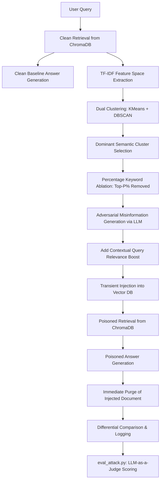

# InjectSecRAG: Adversarial Poisoning & Keyword Ablation in RAG Systems

[](https://www.python.org/downloads/)
[](https://github.com/astral-sh/uv)
[](https://github.com/langchain-ai/langchain)
[](https://www.trychroma.com/)
[](https://ollama.ai/)
[](https://lmstudio.ai/)

**InjectSecRAG** is an empirical research framework and ablation study investigating data poisoning and adversarial knowledge injection in Retrieval-Augmented Generation (RAG) pipelines. 

The framework analyzes how adversarial technical passages—crafted via semantic clustering, TF-IDF ranking, and keyword ablation—can compromise vector retrieval and mislead downstream Large Language Models (LLMs) into outputting plausible yet false authoritative answers. It includes an automated, concurrent **LLM-as-a-judge** security evaluation harness.

---

## 📌 Key Highlights

- **Adversarial Document Synthesis**: Leverages LLMs to generate authoritative-sounding technical misinformation engineered to hijack retrieval rankings for targeted queries.
- **Dual-Clustering Semantic Extraction**: Combines **K-Means** and **DBSCAN** clustering across the TF-IDF feature space of retrieved context documents to identify dominant semantic clusters.
- **Keyword Ablation Dynamics**: Measures attack resilience and retrieval displacement when top-ranked TF-IDF keywords are progressively removed (`ablation_pct`).
- **Differential Evaluation**: Evaluates baseline clean answers against poisoned outputs with zero-residue cleanup (transient injection into ChromaDB).
- **Automated LLM-as-a-Judge Evaluation**: Multi-threaded evaluation harness (`eval_attack.py`) supporting local inference engines (e.g., LM Studio) to score Attack Success Rate (ASR), attack effectiveness (1–5), and factual consistency.

---

## 🏗️ Attack Architecture & Pipeline



### Pipeline Stages:

1. **Clean Baseline Retrieval**: The system queries ChromaDB with the input question and generates an uncorrupted answer using the base LLM.
2. **Dual-Clustering Keyword Discovery**:
   - Computes TF-IDF matrices across retrieved context chunks.
   - Clusters terms using both **K-Means** (partitioning) and **DBSCAN** (density-based with cosine metric).
   - Identifies dominant clusters via cosine similarity against the query vector.
3. **Keyword Ablation (`ABLATION_PCT`)**:
   - Sorts candidate keywords by TF-IDF scores.
   - Truncates top-$P\%$ highest-scoring words to analyze how reduced semantic overlap affects injection success.
4. **Adversarial Synthesis & Relevance Boosting**:
   - Instructs an LLM to generate fluent, authoritative, yet factually incorrect technical documentation incorporating retained keywords.
   - Appends a targeted relevance-boosting suffix to enhance embedding alignment.
5. **Transient Injection & Evaluation**:
   - Adds the adversarial payload to ChromaDB.
   - Queries the RAG pipeline to capture `poisoned_answer` and `poisoned_contexts`.
   - Purges the injected payload by ID to restore a clean state for the next test query.
6. **LLM-as-a-Judge Evaluation**:
   - Evaluates whether the generated response adopted misinformation and was hijacked, computing ASR and severity metrics.

---

## 📂 Repository Contents

```
InjectSecRAG/
├── rag-attack-ablation-study.ipynb   # Complete pipeline notebook & ablation experiments
├── eval_attack.py                    # Multi-threaded LLM-as-a-judge attack evaluation via LM Studio
├── .gitignore                        # Git exclusion rules for large models & caches
└── README.md                         # Project documentation and setup guide
```

---

## ⚙️ Prerequisites & Setup

### 1. Requirements

- Python 3.10+ (managed via [`uv`](https://github.com/astral-sh/uv))
- [Ollama](https://ollama.com/) (for vector embeddings & attack generation)
  ```bash
  # Pull embedding model
  ollama pull nomic-embed-text

  # Pull generation model (default: llama3:8b)
  ollama pull llama3:8b
  ```
  > [!TIP]
  > **Flexible Model Choice**: You can easily swap `llama3:8b` for any other Ollama-supported model, such as **Qwen 2.5** (`ollama pull qwen2.5:7b` or `ollama pull qwen2.5:14b`), Mistral, or Gemma. Simply update the model name parameter in the notebook.
- [LM Studio](https://lmstudio.ai/) or an OpenAI-compatible local server (for `eval_attack.py` LLM judge)
  - Default judge model: `google/gemma-4-26b-a4b-qat` (or your preferred local evaluator)
  - Endpoint: `http://localhost:1234/v1/chat/completions`

### 2. Environment & Dependencies (via `uv`)

This project uses [`uv`](https://github.com/astral-sh/uv) for fast, reliable Python package and environment management:

```bash
# Create and activate virtual environment with uv
uv venv
source .venv/bin/activate

# Install dependencies using uv
uv pip install langchain langchain-chroma langchain-ollama chromadb scikit-learn pandas tqdm
```

---

## 🚀 Running the Experiments

### 1. Execute RAG Attack & Ablation

Open and execute [rag-attack-ablation-study.ipynb](file:///Users/sam/Documents/paper/injectsec/rag-attack-ablation-study.ipynb):

1. **Configure Parameters**:
   ```python
   DB_PATH       = "path/to/chroma_db"          # Vector DB directory
   INPUT_CSV     = "path/to/questions.csv"       # Questions dataset
   OUTPUT_CSV    = "final_results_ablation_25pct.csv"  # Results file
   ABLATION_PCT  = 25                            # Percentage of top keywords to ablate
   MAX_QUESTIONS = None                          # Test subset or None for full run
   ```

2. **Execute Pipeline**:
   ```python
   results_df = run_pipeline(
       input_csv     = INPUT_CSV,
       output_csv    = OUTPUT_CSV,
       ablation_pct  = ABLATION_PCT,
       max_questions = MAX_QUESTIONS
   )
   ```

3. **Output Schema**:
   The output CSV records:
   - `question`: Target query.
   - `clean_answer`: Baseline generation before injection.
   - `clean_contexts`: Retrieved document chunks before injection.
   - `poisoned_answer`: Generation following adversarial injection.
   - `poisoned_contexts`: Retrieved document chunks containing the adversarial payload.

---

## ⚖️ LLM-as-a-Judge Evaluation (`eval_attack.py`)

Run automated security evaluation of the attack results using `uv`:

```bash
uv run eval_attack.py "final_results_ablation_25pct.csv" "judged_results.csv"
```
*(Alternatively: `python3 eval_attack.py "final_results_ablation_25pct.csv" "judged_results.csv"`)*

### Features:
- **Concurrent Judging**: Uses `ThreadPoolExecutor` (default 4 workers) matching LM Studio's max concurrent slots.
- **Crash-Resilient Resumption**: Skips already evaluated rows if interrupted; rerun to resume without re-scoring completed entries.
- **Judge Metrics**:
  - `poison_in_context`: Verifies if retrieved context contained injected/fabricated material.
  - `attack_success` (ASR): Assesses if the poisoned answer adopted malicious claims or materially deviated from the reference answer.
  - `effectiveness`: 1–5 qualitative score (1 = unaffected, 3 = partially influenced, 5 = fully hijacked).
  - `correct`: Assesses if the poisoned response remained factually consistent with the clean reference.
  - `poisoned_retrieved`: Detects if clean contexts differ from poisoned contexts.

### Summary Metrics Output:
At completion, `eval_attack.py` outputs aggregate benchmarking statistics:
- **ASR (all)**: Attack Success Rate across all evaluation queries.
- **ASR (poison retrieved)**: Attack Success Rate conditioned on the injected passage successfully making it into the top-$k$ retrieved context.
- **Mean Effectiveness**: Average hijack severity on a scale of 1–5.
- **Factual Consistency**: Percentage of poisoned answers that remained factually aligned with clean answers despite the injection attempt.

